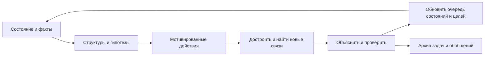

# Поиск, управляемый найденной геометрией

17 ноября 2026. Проект следующего этапа, основанный на просмотре текущего кода.
Описанный здесь поисковый механизм ещё не реализован. Существующие режимы
и результаты испытаний не меняются от добавления этого документа.

Уточнение от 18 ноября: модель геометрической связанности, исключения точек
и задач с дополнительными предпосылками описана в
[STRUCTURE_AND_CONDITIONS.md](STRUCTURE_AND_CONDITIONS.md).

## Измеримое отличие

Следующее действие должно зависеть от конкретных фактов текущего состояния:
какие объекты оказались связаны, что уже объяснено, какая гипотеза проверяется,
какой контрпример получен. У каждого действия должны сохраняться родительское
состояние, правило выбора, факты-основания и цель. Получение результатов
верификации должно менять дальнейшую очередь действий внутри семейства.

Автоматически составленный список story и адаптация бюджета между палитрами
этого требования не выполняют. Перебор остаётся низкоуровневым инструментом;
исследовательская стратегия управляет тем, какие его части и зачем запускать.

Пользователь продолжает задавать семейство: исходные story, допустимые
построения и пределы. Исходные определения сохраняются. Ослабления условий
оформляются отдельными связанными вариантами, в пределах разрешений семейства.
HiddenPoints и ограничения типов/симметрий/стоимости действуют во всех операторах.

## Что уже есть в коде

- `ConfigurationGenerator.cs:40` выполняет DFS; `ExtendConfiguration:101`
  создаёт все допустимые следующие объекты через перебор сигнатур и аргументов.
- `ProblemGenerator.cs:84` держит стеки PicturesOfConfiguration,
  ContextualPicture и TheoremMap. Код прямо предполагает DFS.
- `IGeometryConstructor.ConstructByCloning` умеет достраивать один объект
  к существующим картинкам; ContextualPicture также умеет клонироваться.
- `ITheoremFinder.FindAllTheorems/FindNewTheorems` дают факты начального
  состояния и приращения. ContextualPicture содержит неявные прямые/окружности
  с принадлежащими им точками. Их можно использовать для поиска мотивов.
- `IObjectIntroducer` уже предлагает вспомогательные объекты пруверу.
  Его правила описывают связи построений и полезны как часть каталога действий;
  сами по себе они ещё не задают исследовательскую стратегию.
- `GeneratedProblemAnalyzer.cs:76` передаёт OldTheorems пруверу как известные.
  `TheoremProver.cs:206` маркирует их AssumedProven. Доказательство относительно
  этих фактов отличается от доказательства из пользовательских условий.
- `discovery.py:95` выбирает очередное задание из заранее составленного банка
  по статистике направлений; обратной связи на уровне геометрического состояния нет.

Следовательно, следует переиспользовать конструктор и finder, выделив явное
состояние и операцию одного шага. Простая замена Stack на PriorityQueue сломает
соответствие кэшей ветвям и не даст нужного механизма.

## Состояние исследования

Хранить типизированный граф определений и отдельный граф фактов:

- исходная база и полный путь её дополнения, стоимость от исходных объектов;
- ограничения области применимости, ветви построений, seed и версия движков;
- факты, найденные на картинках, с числом/областью проб;
- доказанные факты с сертификатами и точным списком предпосылок;
- объяснённые стандартные следствия и ссылки на известные семейства;
- активные гипотезы, способы их проверки и контрпримеры;
- уже выполненные и отложенные действия, причины приоритетов и происхождение.

Наблюдаемый факт может мотивировать действие, но не становится доказанной
посылкой. Относительный вывод из наблюдаемых предположений хранит их список.
Абсолютная классификация стандартности требует замкнутого вывода из условий
семейства и поддержанных определений. Сложный факт-предок и его простое
следствие можно объединить в семейство результатов, сохранив сам факт-предок.

Изменения представления, которые finder называет invalidOldTheorems
(например, появилось имя точки пересечения прежде неявно конкурентных прямых),
должны обновлять представление одного факта, а не терять его происхождение.

Начальные факты тоже анализируются и архивируются: перенос дополнения
в начальную конфигурацию не должен прятать найденное утверждение или его стоимость.

## Два взаимосвязанных направления поиска

### От структуры к действиям

Операторы выбирают небольшие наборы конкретных аргументов по графу фактов.
Первый набор операторов:

1. Четыре или более именованных точек неожиданно образовали окружность:
   рассмотреть её центр и диаметр, связи с имеющимися центрами/прямыми.
2. Две содержательные окружности имеют общую именованную точку:
   рассмотреть второе пересечение и его связи с объектами обеих конфигураций.
3. Найдена частичная группа проекций, середин или касательных:
   предложить геометрически согласованное завершение, включая симметричный пакет.
4. Одинаковый объект имеет разные поддержанные описания:
   зафиксировать тождество, объединить представления и рассмотреть связи между
   исходными фрагментами. Проверка одного совпадения координат для объединения
   недостаточна; до подтверждения хранить гипотезу эквивалентности.
5. Два фрагмента имеют общий базовый объект, но мало изученных связей:
   предложить ограниченные пересечения, проекции или центры, соединяющие их.
6. Библиотека введения вспомогательных объектов предлагает объект для
   конкретной активной цели: проверить его полезность и включить в очередь.

Три произвольные неколлинеарные точки всегда задают окружность, поэтому
само наличие такой окружности не является сильным сигналом. Аналогично,
статистику нельзя накачивать всеми парами точек и их прямыми. Нужны дополнительные
принадлежности, независимые происхождения или связь с конкретной гипотезой.

Каждое действие содержит правило, аргументы, факты-основания, ожидаемую связь
и оценку стоимости. Объект создаётся только разрешёнными построениями.
Неявная окружность не даёт права бесплатно добавить отсутствующую в палитре
операцию; материализация её центра также входит в бюджет.

### От гипотезы к действиям

Планировщик хранит явные цели: связанность двух найденных фрагментов,
предполагаемую конкурентность, вписанность, равенство отношений и т. п.
Обратные шаблоны из геометрических правил предлагают недостающие объекты
и вспомогательные леммы. Сначала достаточно ограниченной библиотеки шаблонов;
полное обращение произвольного правила прувера требует отдельного проектирования.

Создание точки как пересечения l и m сразу объясняет её принадлежность l,m.
Это полезное действие для изучения её отношений с третьим фрагментом,
но определяющие принадлежности не являются самостоятельной находкой.
Ожидаемые последствия действия явно помечаются; оцениваются дополнительные связи.

Численная близость на одной случайной картинке не служит основным сигналом.
Кандидат в связь проверяется на нескольких независимых допустимых картинках.
Поиск равенств углов/отношений как промежуточных фактов можно добавить раньше,
чем полноценную публикацию этих типов задач в существующем интерфейсе.

Отдельный генератор гипотез может искать соотношения между величинами:
направленными углами, отношениями отрезков, квадратами расстояний, скалярными
произведениями и степенями точек. Начать с малых геометрически связанных
наборов признаков, небольших коэффициентов и ограниченной степени выражений.
Линейная алгебра на серии картинок помогает предложить формулу; новые
независимые картинки и символические проверки испытывают её отдельно.
Контролировать размер класса выражений относительно числа проб, ориентацию,
периодичность углов и ненулевые знаменатели. Подгонка произвольного многочлена
под конечную выборку не является открытием закономерности.

Такой внутренний язык гипотез расширяет нынешние девять типов утверждений.
Найденное отношение может мотивировать центр гомотетии или проверку подобия;
угловая связь — проверку общей окружности. Полная публикация новых типов
в TheoremFinder/Geometry и их независимая верификация требуют отдельной поддержки.
В первый рабочий этап достаточно включить один узкий класс соотношений,
с отдельными разведочными и проверочными картинками.

## Цикл работы и выбор бюджета

Первый планировщик — ограниченная очередь перспективных состояний с квотами
разнообразия и сохранённым резервом. Приоритет зависит от подтверждённого
выхода новых семейств, стоимости действий, разнообразия структур и целей.
Начальные веса и доли исследования — параметры эксперимента, а не установленная
формула красоты. Доля бюджета сохраняется для ещё не продуктивных направлений.

Разрешить короткие планы из двух-трёх связанных действий: содержательный факт
может появиться после завершения пакета. Действия предков получают отложенную
оценку по подтверждённому результату потомка. Разворачивать следующие действия
постепенно, а не материализовывать всё комбинаторное дерево заранее.

Стандартный факт полезен для планирования и замыкания; он не повод удалять
всю конфигурацию. Конфигурация без немедленной находки остаётся доступна резерву.
Любое ограничение ширины делает поиск неполным — это явная плата за бюджет.

MCTS или обучаемое ранжирование можно сравнивать позднее на накопленных
траекториях. Первый механизм должен показывать, какие факты и правила
обусловили выбор, и иметь простой режим без этих сигналов для сравнения.

## Проверки становятся обратной связью

| Ответ проверки | Действие исследовательского контура |
|---|---|
| Короткий стандартный вывод | Сохранить его для замыкания и распознавания повторных следствий; использовать структуру для дальнейших действий |
| Найдено обобщение | Связать частный случай с общим, проверить общий отдельно и перенаправить доступный бюджет в это семейство |
| Контрпример | Сохранить область/ветвь отказа, пересмотреть гипотезу и действия, которые на неё опирались |
| Таймаут или unknown | Сохранить неопределённость; повторять выборочно по бюджету, не начислять награду за сложность |
| Проверенная новая связь | Архивировать, добавить новые мотивированные действия и обновить приоритеты предков |

Успешные пробы остаются проверкой гипотезы, не доказательством. Замыкание
требует проверенных посылок. Контрпример на тупоугольном треугольнике не даёт
права молча добавить остроугольность к исходному семейству.

Обобщать связанные определения совместно. Пример: E=AC∩BD в циклическом
ABCD, F=mid(AE), G=mid(BE), и C,D,F,G вписаны. Вместо отдельных ослаблений
двух середин проверить общий параметр F=E+t(A−E), G=E+t(B−E).
Тогда степень E показывает происхождение всей семьи. Пробы по t помогают
найти гипотезу обобщения; доказательство общей семьи требует символического
вывода с областью допустимости и вырождениями. Частные случаи не считаются
несколькими новыми задачами.

## Реализация с минимальной заменой рабочих компонентов

1. Выделить из ProblemGenerator построение/анализ одного явно заданного
   состояния. Отвязать picture/theorem caches от текущего стека DFS.
   Переиспользовать ConstructByCloning, ContextualPicture и finder.
2. Экспортировать полный снимок фактов и их приращения, включая исходную
   конфигурацию. Ввести происхождение и статусы относительных выводов.
3. Выделить генерацию разрешённых одношаговых действий из ExtendConfiguration
   в переиспользуемый сервис. Добавить предложения по мотивам и явным целям.
4. Добавить долгоживущий C#-worker для раскрытия состояний. Python-диспетчер
   хранит очередь и SQLite, C# сохраняет ограниченный LRU численных контекстов.
   Для вытесненного состояния контекст восстанавливается из определений и seed;
   не сериализовать внутренние CLR-объекты как постоянный формат.
5. В базе хранить состояния, цели, действия, факты, результаты проверок
   и связи происхождения. Действия брать через lease, результаты применять
   идемпотентно, статистику обновлять один раз на завершение.
6. Подключить существующие фильтры/Geometry к новому контуру и возвращать
   ответы в очередь исследования. Явно обрабатывать обратную связь, пришедшую
   после запуска дочерней ветви.

Добавить управляемые seeds геометрии и раздельные потоки случайности
для выбора действий, разведочных картинок и независимой проверки.
Использование тех же картинок для выбора гипотезы и окончательной проверки
даёт смещённую оценку качества.

Полный граф определений остаётся постоянным источником истины. Состояния
объединяются структурно; геометрические совпадения проходят отдельное
подтверждение. Численный отпечаток помогает найти кандидатов на объединение,
но сам по себе не доказывает эквивалентность и не удаляет ветвь.

Обычный режим GeoGen и существующие кампании сохраняют прежнюю семантику.
Новый исследовательский режим требует собственной версии состояния/каталога;
его разработка не должна незаметно менять старые задания.

## Первый проверяемый этап

Ограничить первую версию тремя механизмами: найденные окружности → центры;
связанные окружности → второе пересечение; связанные середины/проекции →
согласованное завершение. Сразу включить анализ исходных фактов, динамическую
очередь и журнал объяснений выбора, а также хотя бы одно действие,
мотивированное явной гипотезой. Работать на существующих пользовательских семействах.

Критерии готовности:

- изменение фактов при тех же доступных объектах меняет предложения действий;
- журнал показывает цепочку «факт → действие → новые связи → следующая цель»;
- новое действие может появиться после результата проверки и отсутствовать
  в начальной очереди; механизм не сводится к пересортировке готового банка;
- промежуточное стандартное следствие не закрывает все его продолжения;
- исходные/скрытые точки, полная глубина и стоимость макросов учитываются;
- proof из наблюдаемой предпосылки остаётся условным до подтверждения посылки;
- вырожденный пример, контрпример, повтор, таймаут и прерывание обрабатываются
  воспроизводимо; сохранённая очередь продолжается без повторного зачёта работы.

После этого добавлять обобщения с общими параметрами, отношения/степень точки,
семантическое объединение и более сильные операторы планирования.

## Как понять, принесло ли это пользу

Сравнить на одинаковых исходных семействах, ограничениях и общих CPU-бюджетах:

1. обычный DFS;
2. текущую фабрику входов с теми же новыми проверками;
3. новую очередь состояний с простым выбором действий без геометрических сигналов;
4. ту же очередь с мотивами, гипотезами и обратной связью проверок.

Это отделяет пользу нового хранения и распределения от пользы выбора по геометрии.
Учитывать всё время: анализ мотивов, построение, дедупликацию, проверку,
обобщение и подготовку. Запустить несколько seeds и отложенные семейства.
Общий справочный архив заморозить для сравниваемых вариантов, а не давать
последнему запуску преимущество от результатов предыдущего.

Метрики: уникальные проверенные семейства за CPU-час; доля коротких стандартных
следствий и контрпримеров; стоимость одного принятого семейства; покрытие тем;
избыточность формулировки; стабильность при смене seed. На небольшой слепой
выборке дополнительно оценить математическую содержательность человеком.
Неизвестность пруверу не является мерой трудности, а отсутствие в локальном
архиве не доказывает мировую новизну. Если полный режим не превосходит
контрольную очередь и текущую фабрику, менять операторы/оценку, а не объявлять
смену архитектуры успешным исследованием.
